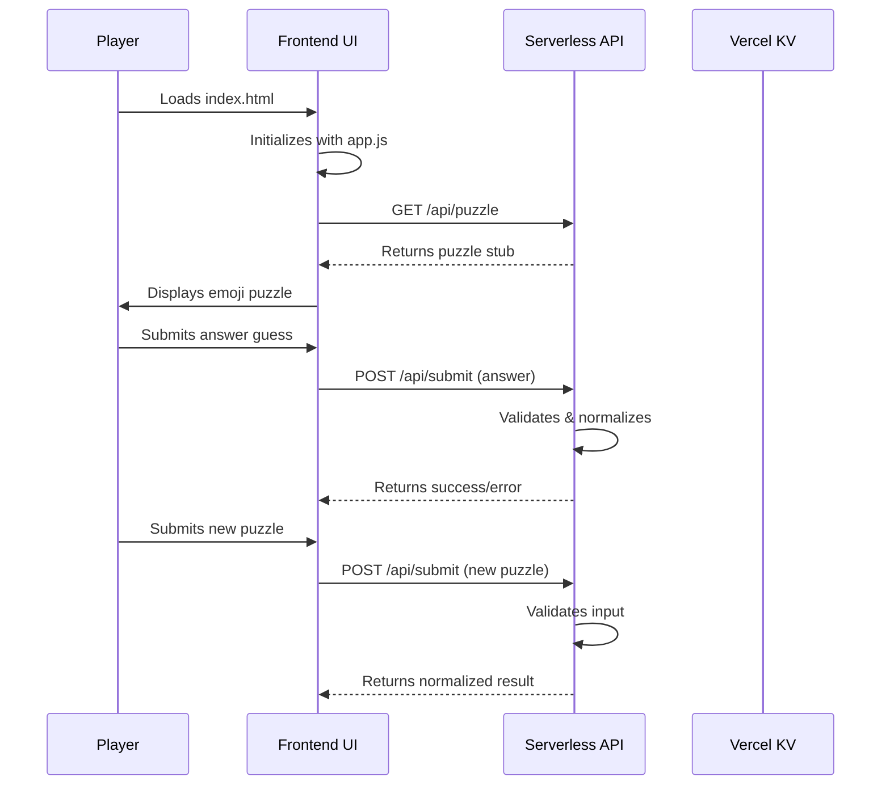

# Design Document: Emoji Rebus Blitz Initial Layout

## Overview

This design implements the initial project layout for the Emoji Rebus Blitz game - a single-player web puzzle game where players decode emoji rebus puzzles against a 30-second timer. The design focuses on establishing the complete file skeleton with root configs, static frontend shell, and backend API routes before any application logic is written.

## Main Algorithm/Workflow



## Components and Interfaces

### Component 1: API Server

**Purpose**: Handle HTTP requests for puzzle data and submissions

**Interface**:
```pascal
INTERFACE ApiServer
  METHOD getPuzzle(): PuzzleData
  METHOD submitPuzzle(request: SubmitRequest): SubmitResponse
  METHOD getHealth(): HealthResponse
END INTERFACE
```

**Responsibilities**:
- Serve puzzle data to frontend
- Validate and process puzzle submissions
- Provide health status for monitoring

### Component 2: Validation Engine

**Purpose**: Validate user inputs and normalize data

**Interface**:
```pascal
INTERFACE ValidationEngine
  METHOD validateSubmitRequest(request: SubmitRequest): ValidationResult
  METHOD normalizeAnswer(answer: String): String
  METHOD containsEmoji(text: String): Boolean
END INTERFACE
```

**Responsibilities**:
- Enforce input validation rules
- Normalize answer strings
- Detect emoji presence in text

## Data Models

### Model 1: PuzzleData

```pascal
STRUCTURE PuzzleData
  emoji: String
  hint: String
END STRUCTURE
```

**Validation Rules**:
- emoji must contain at least one emoji character
- hint must be non-empty string

### Model 2: SubmitRequest

```pascal
STRUCTURE SubmitRequest
  emoji: String
  answer: String
  hint: String
END STRUCTURE
```

**Validation Rules**:
- All fields required
- emoji must contain at least one emoji
- answer will be normalized during processing

### Model 3: SubmitResponse

```pascal
STRUCTURE SubmitResponse
  success: Boolean
  message: String
  normalizedAnswer: String
END STRUCTURE
```

**Validation Rules**:
- success indicates validation result
- message provides user feedback
- normalizedAnswer contains processed answer string

### Model 4: HealthResponse

```pascal
STRUCTURE HealthResponse
  status: String
  ts: Timestamp
END STRUCTURE
```

**Validation Rules**:
- status must be "ok" for healthy system
- ts must be current ISO timestamp

### Model 5: GameState

```pascal
STRUCTURE GameState
  score: Integer
  timeRemaining: Integer
  currentPuzzle: PuzzleData
  feedback: String
END STRUCTURE
```

**Validation Rules**:
- score must be non-negative integer
- timeRemaining must be between 0 and 30 seconds
- currentPuzzle must be valid PuzzleData

## Key Functions with Formal Specifications

### Function 1: validateSubmitRequest()

```pascal
FUNCTION validateSubmitRequest(request: SubmitRequest): ValidationResult
```

**Preconditions:**
- `request` is non-null object
- `request.emoji` is defined string
- `request.answer` is defined string  
- `request.hint` is defined string

**Postconditions:**
- Returns ValidationResult object
- If valid: `result.valid === true` and `result.normalizedAnswer` contains normalized answer
- If invalid: `result.valid === false` and `result.error` contains descriptive message
- No mutations to input request

**Validation Rules:**
- All fields must be non-empty strings
- Emoji field must contain at least one emoji character
- Answer is normalized to lowercase, stripped of non-alphanumeric characters (spaces allowed)

### Function 2: normalizeAnswer()

```pascal
FUNCTION normalizeAnswer(answer: String): String
```

**Preconditions:**
- `answer` is defined string

**Postconditions:**
- Returns normalized string
- All uppercase characters converted to lowercase
- Non-alphanumeric characters removed (except spaces)
- No side effects on input

### Function 3: containsEmoji()

```pascal
FUNCTION containsEmoji(text: String): Boolean
```

**Preconditions:**
- `text` is defined string

**Postconditions:**
- Returns boolean value
- `true` if text contains at least one emoji character
- `false` if text contains no emoji characters
- No mutations to input text

## Algorithmic Pseudocode

### Main Validation Algorithm

```pascal
ALGORITHM validateSubmission
INPUT: request of type SubmitRequest
OUTPUT: result of type ValidationResult

BEGIN
  // Check field presence
  IF request.emoji IS EMPTY OR request.answer IS EMPTY OR request.hint IS EMPTY THEN
    RETURN ValidationResult(valid: false, error: "All fields are required.")
  END IF
  
  // Check emoji presence
  IF NOT containsEmoji(request.emoji) THEN
    RETURN ValidationResult(valid: false, error: "Emoji field must contain at least one emoji.")
  END IF
  
  // Normalize answer
  normalized ← normalizeAnswer(request.answer)
  
  RETURN ValidationResult(valid: true, normalizedAnswer: normalized)
END
```

**Preconditions:**
- request has emoji, answer, hint fields
- All string validation functions available

**Postconditions:**
- Returns validation result
- If valid, includes normalized answer
- If invalid, includes descriptive error message

### Normalization Algorithm

```pascal
ALGORITHM normalizeAnswer
INPUT: answer of type String
OUTPUT: normalized of type String

BEGIN
  normalized ← answer
  
  // Convert to lowercase
  normalized ← TO_LOWERCASE(normalized)
  
  // Remove special characters (keep letters, numbers, spaces)
  FOR each character IN normalized DO
    IF NOT (IS_ALPHANUMERIC(character) OR character = ' ') THEN
      REMOVE character FROM normalized
    END IF
  END FOR
  
  RETURN normalized
END
```

**Preconditions:**
- answer parameter is provided
- Character classification functions available

**Postconditions:**
- Returns normalized string
- All letters lowercase
- Non-alphanumeric characters removed (except spaces)

## Example Usage

```pascal
// Example 1: API puzzle endpoint
SEQUENCE
  puzzle ← GET /api/puzzle
  DISPLAY puzzle.emoji
  DISPLAY puzzle.hint
END SEQUENCE

// Example 2: Submit validation
SEQUENCE
  request ← {emoji: "🌊🏄‍♂️", answer: "Surfing!", hint: "Something surfers do"}
  result ← validateSubmission(request)
  
  IF result.valid THEN
    DISPLAY "Submission accepted: " + result.normalizedAnswer
  ELSE
    DISPLAY "Error: " + result.error
  END IF
END SEQUENCE

// Example 3: Answer normalization
SEQUENCE
  original ← "Spider-Man!"
  normalized ← normalizeAnswer(original)
  // normalized = "spiderman"
END SEQUENCE
```

## Correctness Properties

*A property is a characteristic or behavior that should hold true across all valid executions of a system-essentially, a formal statement about what the system should do. Properties serve as the bridge between human-readable specifications and machine-verifiable correctness guarantees.*

### Property 1: Normalization preserves alphanumeric content

*For any* input string containing only alphanumeric characters and spaces, the normalizeAnswer function SHALL return an equivalent string with all characters converted to lowercase

**Validates: Requirements 3.3, 4.4, 4.5**

### Property 2: Validation rejects empty fields

*For any* SubmitRequest where any field (emoji, answer, or hint) is an empty string, the validateSubmission function SHALL return a validation error indicating "All fields are required."

**Validates: Requirements 3.4**

### Property 3: Emoji detection consistency

*For any* string containing at least one emoji character, the containsEmoji function SHALL return true, and *for any* string containing no emoji characters, it SHALL return false

**Validates: Requirements 3.5**

### Property 4: Special character removal

*For any* input string, after normalization, the result SHALL contain only lowercase letters, numbers, and spaces

**Validates: Requirements 4.4**

### Property 5: API endpoint method enforcement

*For any* HTTP request to `/api/puzzle` using a non-GET method, the endpoint SHALL return 405 Method Not Allowed

**Validates: Requirements 3.2**

### Property 6: Submission endpoint validation

*For any* POST request to `/api/submit` with valid input, the endpoint SHALL return a success response with normalized answer

**Validates: Requirements 3.6**

## Architecture

The system follows a client-server architecture with:

1. **Frontend Layer**: Static HTML/CSS/JS served from `/public` directory
2. **API Layer**: Serverless functions in `/api` directory handling game logic
3. **Data Layer**: Vercel KV (Redis) for puzzle storage (implementation deferred to Spec 002)
4. **Configuration Layer**: Root config files for runtime and deployment

## File Structure

```
emoji-rebus-blitz/
├── .env.local                  # KV credential placeholders
├── .gitignore
├── package.json               # ESM, @vercel/kv dep, vercel dev scripts
├── README.md
├── vercel.json                # Routing + Node 20.x runtime config
├── api/
│   ├── health.js              # GET /api/health
│   ├── puzzle.js              # GET /api/puzzle
│   └── submit.js              # POST /api/submit
├── public/
│   ├── index.html             # Semantic HTML shell
│   ├── style.css              # Grid/flex layout skeleton
│   └── app.js                 # ES module stub
└── .kiro/
    ├── steering/
    │   └── project.md
    ├── specs/
    │   └── initial-layout/
    │       ├── .config.kiro
    │       └── design.md
    └── hooks/
```

## Error Handling

### Error Scenario 1: Invalid HTTP Method

**Condition**: When non-allowed HTTP method is used for API endpoints
**Response**: Return 405 Method Not Allowed with appropriate error message
**Recovery**: Client should retry with correct HTTP method

### Error Scenario 2: Missing Required Fields

**Condition**: When submission request lacks required fields
**Response**: Return 400 Bad Request with descriptive error
**Recovery**: User should fill all required fields and resubmit

### Error Scenario 3: No Emoji in Emoji Field

**Condition**: When emoji field contains no emoji characters
**Response**: Return 400 Bad Request with validation error
**Recovery**: User should include at least one emoji character

## Testing Strategy

### Unit Testing Approach
- Test individual validation functions (normalizeAnswer, containsEmoji)
- Test API endpoint response formats
- Test error handling for invalid inputs

### Property-Based Testing Approach
- Test normalization properties across random string inputs
- Test validation consistency with various input combinations
- Test method enforcement across all API endpoints

### Integration Testing Approach
- Test end-to-end API calls with stubbed responses
- Verify file structure and configuration validity
- Test routing behavior with vercel dev

## Dependencies

- Node.js 20.x runtime environment
- @vercel/kv package for Redis integration
- Vercel CLI for local development
- Modern web browser for frontend testing