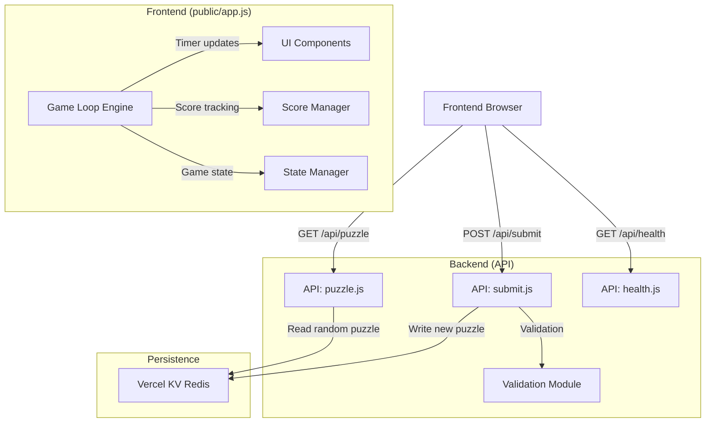
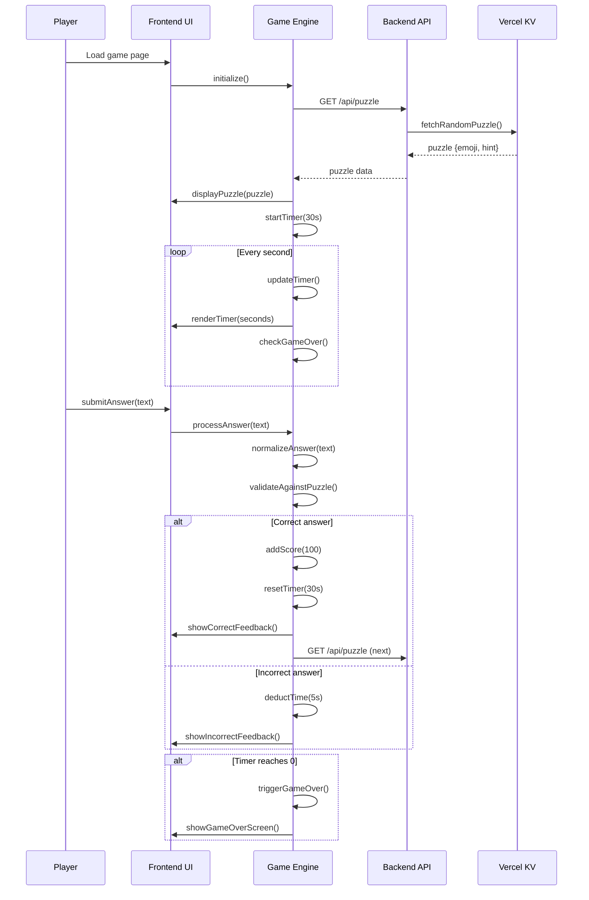
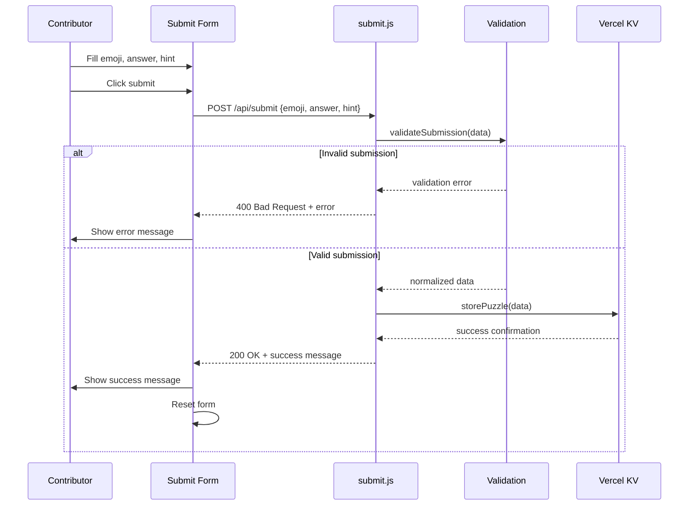

# Design Document: KV Integration & Live Game Loop

## Overview

This design document specifies the KV (Key-Value) integration and live game loop implementation for the Emoji Rebus Blitz game. Building upon Spec 001's initial layout, this spec implements the core game mechanics: connecting to Vercel KV for puzzle storage and retrieval, implementing a 30-second countdown timer with score tracking, and enabling user submissions to grow the puzzle database. The system will provide a responsive, real-time gaming experience with proper error handling and data validation.

## Architecture



## Sequence Diagrams

### Main Game Loop Flow



### Crowdsourcing Submission Flow



## Components and Interfaces

### Component 1: KV Puzzle Manager (Backend)

**Purpose**: Manages puzzle storage and retrieval from Vercel KV

**Interface**:
```javascript
/**
 * KV Puzzle Manager - Interface for Vercel KV operations
 */
class KVPuzzleManager {
  /**
   * Initialize connection to Vercel KV
   * @param {string} url - KV REST API URL
   * @param {string} token - KV REST API token
   */
  constructor(url, token) {}
  
  /**
   * Fetch a random puzzle from KV storage
   * @returns {Promise<Puzzle>} Random puzzle object
   * @throws {Error} If KV connection fails or no puzzles available
   */
  async fetchRandomPuzzle() {}
  
  /**
   * Store a new puzzle in KV storage
   * @param {Puzzle} puzzle - Puzzle object to store
   * @returns {Promise<boolean>} True if successful
   * @throws {Error} If KV connection fails or puzzle invalid
   */
  async storePuzzle(puzzle) {}
  
  /**
   * Get total count of puzzles in KV
   * @returns {Promise<number>} Puzzle count
   */
  async getPuzzleCount() {}
  
  /**
   * Seed initial puzzle dataset
   * @param {Array<Puzzle>} puzzles - Initial puzzles to seed
   * @returns {Promise<number>} Number of puzzles seeded
   */
  async seedInitialPuzzles(puzzles) {}
}

/**
 * Puzzle data structure
 * @typedef {Object} Puzzle
 * @property {string} id - Unique identifier (UUID)
 * @property {string} emoji - Emoji rebus string
 * @property {string} answer - Correct answer (normalized)
 * @property {string} hint - Helpful hint text
 * @property {string} createdAt - ISO timestamp
 * @property {number} usageCount - Number of times shown
 */
```

### Component 2: Game Engine (Frontend)

**Purpose**: Manages game state, timer, score, and user interactions

**Interface**:
```javascript
/**
 * Game Engine - Core game logic and state management
 */
class GameEngine {
  /**
   * Initialize game engine with configuration
   * @param {Object} config - Game configuration
   * @param {number} config.initialTime - Initial timer seconds (default: 30)
   * @param {number} config.correctBonus - Points for correct answer (default: 100)
   * @param {number} config.incorrectPenalty - Time penalty for incorrect (default: 5)
   */
  constructor(config = {}) {}
  
  /**
   * Start a new game session
   * @param {Puzzle} initialPuzzle - First puzzle to display
   */
  startGame(initialPuzzle) {}
  
  /**
   * Process player's answer
   * @param {string} playerAnswer - Player's input answer
   * @returns {AnswerResult} Result of answer processing
   */
  processAnswer(playerAnswer) {}
  
  /**
   * Fetch next puzzle from API
   * @returns {Promise<Puzzle>} Next puzzle
   */
  async fetchNextPuzzle() {}
  
  /**
   * Get current game state
   * @returns {GameState} Current game state
   */
  getState() {}
  
  /**
   * Reset game to initial state
   */
  resetGame() {}
  
  /**
   * Update timer (called every second)
   */
  updateTimer() {}
}

/**
 * Game state structure
 * @typedef {Object} GameState
 * @property {number} score - Current score
 * @property {number} timeRemaining - Seconds remaining
 * @property {Puzzle} currentPuzzle - Current puzzle
 * @property {boolean} isGameOver - Game over flag
 * @property {number} puzzlesSolved - Count of solved puzzles
 */

/**
 * Answer processing result
 * @typedef {Object} AnswerResult
 * @property {boolean} isCorrect - Whether answer was correct
 * @property {number} scoreChange - Points added (positive) or time penalty (negative seconds)
 * @property {string} normalizedAnswer - Normalized version of player's answer
 * @property {string} message - Feedback message
 */
```

### Component 3: Timer Manager (Frontend)

**Purpose**: Manages countdown timer with precision and callbacks

**Interface**:
```javascript
/**
 * Timer Manager - Precise countdown timer with callbacks
 */
class TimerManager {
  /**
   * Create timer with duration and callbacks
   * @param {number} durationSeconds - Timer duration in seconds
   * @param {Object} callbacks - Timer event callbacks
   * @param {Function} callbacks.onTick - Called every second with remaining time
   * @param {Function} callbacks.onComplete - Called when timer reaches 0
   */
  constructor(durationSeconds, callbacks = {}) {}
  
  /**
   * Start the timer
   */
  start() {}
  
  /**
   * Pause the timer
   */
  pause() {}
  
  /**
   * Resume the timer
   */
  resume() {}
  
  /**
   * Reset timer to initial duration
   */
  reset() {}
  
  /**
   * Add time to timer (positive or negative)
   * @param {number} seconds - Seconds to add (can be negative)
   */
  addTime(seconds) {}
  
  /**
   * Get current remaining time
   * @returns {number} Seconds remaining
   */
  getRemainingTime() {}
  
  /**
   * Check if timer is running
   * @returns {boolean} True if timer is active
   */
  isRunning() {}
  
  /**
   * Stop and destroy timer
   */
  destroy() {}
}
```

### Component 4: Validation Module (Shared)

**Purpose**: Validates user submissions and normalizes answers

**Interface**:
```javascript
/**
 * Validation Module - Shared validation logic for frontend and backend
 */
class ValidationModule {
  /**
   * Normalize answer string
   * @param {string} answer - Raw answer string
   * @returns {string} Normalized answer (lowercase, alphanumeric+spaces only)
   */
  static normalizeAnswer(answer) {}
  
  /**
   * Check if string contains at least one emoji
   * @param {string} text - Text to check
   * @returns {boolean} True if contains emoji
   */
  static containsEmoji(text) {}
  
  /**
   * Validate submission data
   * @param {Object} data - Submission data
   * @param {string} data.emoji - Emoji string
   * @param {string} data.answer - Answer text
   * @param {string} data.hint - Hint text
   * @returns {ValidationResult} Validation result
   */
  static validateSubmission(data) {}
  
  /**
   * Validate puzzle data structure
   * @param {Object} puzzle - Puzzle object
   * @returns {ValidationResult} Validation result
   */
  static validatePuzzle(puzzle) {}
}

/**
 * Validation result structure
 * @typedef {Object} ValidationResult
 * @property {boolean} isValid - Whether validation passed
 * @property {Array<string>} errors - Error messages if invalid
 * @property {Object} normalizedData - Normalized data if valid
 */
```

## Data Models

### Model 1: Puzzle Data Structure

```javascript
/**
 * Puzzle data model stored in Vercel KV
 */
interface Puzzle {
  // Unique identifier (generated as UUID v4)
  id: string;
  
  // Emoji rebus string (must contain at least one emoji)
  emoji: string;
  
  // Correct answer (normalized: lowercase, alphanumeric+spaces only)
  answer: string;
  
  // Helpful hint text (1-100 characters)
  hint: string;
  
  // Creation timestamp (ISO string)
  createdAt: string;
  
  // Number of times this puzzle has been shown
  usageCount: number;
  
  // Optional: Creator identifier (if user system implemented)
  creatorId?: string;
}

/**
 * Validation Rules:
 * - id: Must be valid UUID v4
 * - emoji: Must contain at least one emoji character
 * - answer: Must be 1-50 characters after normalization
 * - hint: Must be 1-100 characters
 * - createdAt: Must be valid ISO timestamp
 * - usageCount: Must be non-negative integer
 */
```

### Model 2: Game Session Data

```javascript
/**
 * Game session data (frontend only, not persisted)
 */
interface GameSession {
  // Current score
  score: number;
  
  // Current puzzle
  currentPuzzle: Puzzle | null;
  
  // Time remaining in seconds
  timeRemaining: number;
  
  // Game over flag
  isGameOver: boolean;
  
  // Count of puzzles solved this session
  puzzlesSolved: number;
  
  // Count of incorrect attempts this session
  incorrectAttempts: number;
  
  // Session start time
  sessionStart: Date;
  
  // Last activity timestamp
  lastActivity: Date;
}

/**
 * Validation Rules:
 * - score: Must be non-negative integer
 * - timeRemaining: Must be between 0 and initial time (30)
 * - puzzlesSolved: Must be non-negative integer
 * - incorrectAttempts: Must be non-negative integer
 */
```

### Model 3: Submission Request

```javascript
/**
 * User submission request (POST /api/submit)
 */
interface SubmissionRequest {
  // Emoji rebus string
  emoji: string;
  
  // Correct answer
  answer: string;
  
  // Helpful hint
  hint: string;
}

/**
 * Validation Rules:
 * - All fields required
 * - emoji: Must contain at least one emoji character
 * - answer: Must be 1-50 characters (before normalization)
 * - hint: Must be 1-100 characters
 */
```

### Model 4: API Response Formats

```javascript
/**
 * Standard API response envelope
 */
interface ApiResponse<T = any> {
  // Success flag
  success: boolean;
  
  // Response data
  data?: T;
  
  // Error message (if success = false)
  error?: string;
  
  // Timestamp
  timestamp: string;
}

/**
 * Puzzle API response
 */
interface PuzzleResponse extends ApiResponse {
  data: {
    emoji: string;
    hint: string;
  };
}

/**
 * Submission API response
 */
interface SubmitResponse extends ApiResponse {
  data: {
    message: string;
    normalizedAnswer: string;
    puzzleId?: string;
  };
}

/**
 * Health check response
 */
interface HealthResponse extends ApiResponse {
  data: {
    status: string;
    ts: string;
    kvStatus: string;
    puzzleCount: number;
  };
}
```

## Key Functions with Formal Specifications

### Function 1: fetchRandomPuzzle()

```javascript
/**
 * Fetch a random puzzle from Vercel KV storage
 * @returns {Promise<Puzzle>} Random puzzle object
 */
async function fetchRandomPuzzle(): Promise<Puzzle>
```

**Preconditions:**
- Vercel KV connection is established and healthy
- At least one puzzle exists in KV storage
- Environment variables KV_REST_API_URL and KV_REST_API_TOKEN are set

**Postconditions:**
- Returns a valid Puzzle object
- Puzzle.usageCount is incremented by 1 in KV storage
- Puzzle is selected randomly with uniform distribution
- If no puzzles available, throws Error with message "No puzzles available"

**Loop Invariants:** N/A

### Function 2: processAnswer()

```javascript
/**
 * Process player's answer against current puzzle
 * @param {string} playerAnswer - Player's input answer
 * @returns {AnswerResult} Result of answer processing
 */
function processAnswer(playerAnswer: string): AnswerResult
```

**Preconditions:**
- Game engine is initialized with current puzzle
- playerAnswer is a string (may be empty)
- Timer is running (game not over)
- currentPuzzle is valid and non-null

**Postconditions:**
- Returns AnswerResult object with isCorrect boolean
- If isCorrect: score increases by 100, timer resets to 30 seconds
- If !isCorrect: timeRemaining decreases by 5 seconds (minimum 0)
- playerAnswer is normalized before comparison
- Comparison is case-insensitive and ignores special characters

**Loop Invariants:** N/A

### Function 3: updateTimer()

```javascript
/**
 * Update game timer (called every second)
 */
function updateTimer(): void
```

**Preconditions:**
- Game engine is initialized
- Timer is running (isGameOver = false)
- timeRemaining > 0

**Postconditions:**
- timeRemaining decreases by 1
- If timeRemaining reaches 0: isGameOver = true
- UI displays updated timeRemaining
- onTick callback is invoked with new timeRemaining

**Loop Invariants:**
- timeRemaining >= 0 throughout execution
- isGameOver remains false until timeRemaining = 0

### Function 4: validateSubmission()

```javascript
/**
 * Validate user submission data
 * @param {SubmissionRequest} data - Submission data
 * @returns {ValidationResult} Validation result
 */
function validateSubmission(data: SubmissionRequest): ValidationResult
```

**Preconditions:**
- data is an object with emoji, answer, hint properties
- Properties may be any string value (including empty)

**Postconditions:**
- Returns ValidationResult object with isValid boolean
- If isValid: normalizedData contains normalized fields
- If !isValid: errors array contains descriptive error messages
- Validation checks:
  - All fields non-empty
  - emoji contains at least one emoji
  - answer 1-50 characters (pre-normalization)
  - hint 1-100 characters
- answer field is normalized (lowercase, alphanumeric+spaces only)

**Loop Invariants:** N/A

## Algorithmic Pseudocode

### Main Game Loop Algorithm

```pascal
ALGORITHM mainGameLoop
INPUT: None
OUTPUT: Game session with score and duration

BEGIN
  // Initialize game state
  state ← initializeGameState()
  timer ← createTimer(30, onTick, onComplete)
  
  // Fetch initial puzzle
  puzzle ← fetchRandomPuzzleFromAPI()
  state.currentPuzzle ← puzzle
  displayPuzzle(puzzle)
  
  // Start game loop
  timer.start()
  
  WHILE NOT state.isGameOver DO
    // Wait for player input or timer tick
    event ← waitForEvent({timerTick, answerSubmit})
    
    IF event.type = timerTick THEN
      state.timeRemaining ← state.timeRemaining - 1
      updateTimerDisplay(state.timeRemaining)
      
      IF state.timeRemaining = 0 THEN
        state.isGameOver ← true
        triggerGameOver(state)
      END IF
      
    ELSE IF event.type = answerSubmit THEN
      result ← processAnswer(event.answer, state.currentPuzzle)
      
      IF result.isCorrect THEN
        state.score ← state.score + 100
        state.timeRemaining ← 30
        state.puzzlesSolved ← state.puzzlesSolved + 1
        showCorrectFeedback()
        
        // Fetch next puzzle
        puzzle ← fetchRandomPuzzleFromAPI()
        state.currentPuzzle ← puzzle
        displayPuzzle(puzzle)
        
      ELSE
        state.timeRemaining ← max(0, state.timeRemaining - 5)
        showIncorrectFeedback()
        state.incorrectAttempts ← state.incorrectAttempts + 1
      END IF
      
      updateScoreDisplay(state.score)
    END IF
  END WHILE
  
  RETURN state
END
```

**Preconditions:**
- Game UI is loaded and initialized
- API endpoints are accessible
- Timer system is available

**Postconditions:**
- Game runs until timeRemaining = 0
- Score accumulates based on correct answers
- Timer resets on correct answers, deducts on incorrect
- Game over state triggered when timer reaches 0

**Loop Invariants:**
- state.timeRemaining >= 0
- state.score >= 0
- state.puzzlesSolved >= 0
- state.incorrectAttempts >= 0

### Random Puzzle Selection Algorithm

```pascal
ALGORITHM fetchRandomPuzzle
INPUT: None
OUTPUT: Puzzle object

BEGIN
  // Connect to Vercel KV
  kv ← createKVConnection(KV_URL, KV_TOKEN)
  
  // Get all puzzle IDs
  puzzleIds ← kv.lrange("puzzles:ids", 0, -1)
  
  IF length(puzzleIds) = 0 THEN
    RETURN Error("No puzzles available")
  END IF
  
  // Select random ID
  randomIndex ← randomInteger(0, length(puzzleIds) - 1)
  puzzleId ← puzzleIds[randomIndex]
  
  // Fetch puzzle data
  puzzleData ← kv.hgetall("puzzle:" + puzzleId)
  
  // Increment usage count
  currentCount ← parseInt(puzzleData.usageCount)
  kv.hset("puzzle:" + puzzleId, "usageCount", currentCount + 1)
  
  // Return puzzle
  RETURN {
    id: puzzleId,
    emoji: puzzleData.emoji,
    answer: puzzleData.answer,
    hint: puzzleData.hint,
    createdAt: puzzleData.createdAt,
    usageCount: currentCount + 1
  }
END
```

**Preconditions:**
- Vercel KV connection established
- Puzzle data stored with keys: "puzzles:ids" (list) and "puzzle:{id}" (hash)

**Postconditions:**
- Returns random puzzle with uniform distribution
- Puzzle.usageCount incremented atomically
- If no puzzles, returns Error

**Loop Invariants:**
- Random selection ensures uniform distribution across all puzzles

### Submission Validation Algorithm

```pascal
ALGORITHM validateSubmission
INPUT: data {emoji, answer, hint}
OUTPUT: ValidationResult {isValid, errors, normalizedData}

BEGIN
  errors ← []
  normalizedData ← {}
  
  // Check required fields
  IF data.emoji = "" OR data.emoji = null THEN
    errors.add("Emoji field is required")
  END IF
  
  IF data.answer = "" OR data.answer = null THEN
    errors.add("Answer field is required")
  END IF
  
  IF data.hint = "" OR data.hint = null THEN
    errors.add("Hint field is required")
  END IF
  
  // Validate emoji contains at least one emoji character
  IF NOT containsEmoji(data.emoji) THEN
    errors.add("Emoji field must contain at least one emoji character")
  END IF
  
  // Validate answer length (pre-normalization)
  normalizedAnswer ← normalizeAnswer(data.answer)
  IF length(normalizedAnswer) < 1 OR length(normalizedAnswer) > 50 THEN
    errors.add("Answer must be between 1 and 50 characters")
  END IF
  
  // Validate hint length
  IF length(data.hint) < 1 OR length(data.hint) > 100 THEN
    errors.add("Hint must be between 1 and 100 characters")
  END IF
  
  // Prepare result
  IF length(errors) = 0 THEN
    RETURN {
      isValid: true,
      errors: [],
      normalizedData: {
        emoji: data.emoji,
        answer: normalizedAnswer,
        hint: data.hint.trim()
      }
    }
  ELSE
    RETURN {
      isValid: false,
      errors: errors,
      normalizedData: null
    }
  END IF
END
```

**Preconditions:**
- Input data object exists
- containsEmoji() and normalizeAnswer() functions available

**Postconditions:**
- Returns ValidationResult with validation status
- If valid: normalizedData contains cleaned data
- If invalid: errors contains descriptive messages
- No side effects on input data

**Loop Invariants:** N/A

## Example Usage

```javascript
// Example 1: Game initialization and play
const game = new GameEngine({
  initialTime: 30,
  correctBonus: 100,
  incorrectPenalty: 5
});

// Start game with initial puzzle
const initialPuzzle = await fetch('/api/puzzle').then(r => r.json());
game.startGame(initialPuzzle);

// Player submits answer
const result = game.processAnswer("spiderman");
if (result.isCorrect) {
  console.log(`Correct! +${result.scoreChange} points`);
  // Timer resets to 30s automatically
} else {
  console.log(`Incorrect! -${Math.abs(result.scoreChange)} seconds`);
}

// Example 2: KV integration in backend
import { createClient } from '@vercel/kv';

const kv = createClient({
  url: process.env.KV_REST_API_URL,
  token: process.env.KV_REST_API_TOKEN,
});

// Fetch random puzzle
async function getRandomPuzzle() {
  const puzzleIds = await kv.lrange('puzzles:ids', 0, -1);
  const randomId = puzzleIds[Math.floor(Math.random() * puzzleIds.length)];
  const puzzle = await kv.hgetall(`puzzle:${randomId}`);
  
  // Increment usage count
  await kv.hincrby(`puzzle:${randomId}`, 'usageCount', 1);
  
  return puzzle;
}

// Example 3: User submission
async function submitPuzzle(emoji, answer, hint) {
  const validation = ValidationModule.validateSubmission({ emoji, answer, hint });
  
  if (!validation.isValid) {
    return { success: false, errors: validation.errors };
  }
  
  const puzzle = {
    id: generateUUID(),
    emoji: validation.normalizedData.emoji,
    answer: validation.normalizedData.answer,
    hint: validation.normalizedData.hint,
    createdAt: new Date().toISOString(),
    usageCount: 0
  };
  
  // Store in KV
  await kv.hset(`puzzle:${puzzle.id}`, puzzle);
  await kv.lpush('puzzles:ids', puzzle.id);
  
  return { success: true, puzzleId: puzzle.id };
}

// Example 4: Timer management
const timer = new TimerManager(30, {
  onTick: (remaining) => {
    document.getElementById('timer').textContent = remaining;
  },
  onComplete: () => {
    game.triggerGameOver();
  }
});

timer.start();
```

## Error Handling

### Error Scenario 1: KV Connection Failure

**Condition**: Vercel KV service unavailable or credentials invalid
**Response**: 
- Backend: Return 503 Service Unavailable with { error: "Database unavailable" }
- Frontend: Show graceful error message "Game service temporarily unavailable"
**Recovery**: 
- Implement retry logic with exponential backoff
- Fallback to static puzzle set if KV unavailable
- Log error for monitoring

### Error Scenario 2: No Puzzles Available

**Condition**: KV storage has no puzzles (initial state or data loss)
**Response**:
- Backend: Return 404 Not Found with { error: "No puzzles available" }
- Frontend: Show message "No puzzles available - please submit one!"
**Recovery**:
- Automatically seed with default puzzles if count = 0
- Redirect user to submission form
- Implement admin interface for puzzle management

### Error Scenario 3: Invalid User Submission

**Condition**: User submits invalid data (missing fields, no emoji, etc.)
**Response**:
- Backend: Return 400 Bad Request with specific validation errors
- Frontend: Display error messages next to relevant form fields
**Recovery**:
- Preserve user's input in form fields
- Highlight invalid fields
- Provide clear error messages

### Error Scenario 4: Game Timer Desync

**Condition**: Browser tab inactive causing timer inaccuracies
**Response**:
- Detect tab visibility changes
- Adjust timer based on actual elapsed time
- Provide visual indicator if timer paused
**Recovery**:
- Use requestAnimationFrame for precise timing
- Implement visibility change handlers
- Sync with server time periodically

## Testing Strategy

### Unit Testing Approach

**Frontend Unit Tests**:
- Game engine logic: score calculation, timer updates, answer validation
- Timer manager: start/stop/reset functionality, callback invocation
- Validation module: answer normalization, emoji detection, submission validation

**Backend Unit Tests**:
- KV puzzle manager: random selection, storage operations
- API endpoints: request validation, error responses
- Validation logic: shared validation functions

**Test Coverage Goals**:
- 80% line coverage for core game logic
- 100% coverage for validation functions
- Edge cases: empty inputs, boundary values, error conditions

### Property-Based Testing Approach

**Property Test Library**: fast-check for JavaScript

**Key Properties to Test**:
1. **Answer normalization idempotence**: normalizeAnswer(normalizeAnswer(x)) === normalizeAnswer(x)
2. **Score monotonicity**: Score only increases (never decreases) throughout game
3. **Timer bounds**: timeRemaining always between 0 and initialTime (30)
4. **Game over invariant**: Once isGameOver = true, no further score changes
5. **Submission validation consistency**: Same input always produces same validation result

**Property Test Configuration**:
- Minimum 100 iterations per property
- Generate random emoji strings, answers, hints
- Test edge cases: empty strings, very long strings, special characters

### Integration Testing Approach

**API Integration Tests**:
- End-to-end API calls with mock KV
- Validate response formats and status codes
- Test error conditions and edge cases

**Frontend-Backend Integration**:
- Mock API responses to test frontend handling
- Validate data flow between components
- Test error recovery and user feedback

**KV Integration Tests**:
- Test actual KV connection in development environment
- Validate data persistence and retrieval
- Test concurrent access scenarios

## Performance Considerations

**KV Performance Optimization**:
- Use pipeline for multiple KV operations
- Implement connection pooling
- Cache frequently accessed puzzles
- Monitor KV latency and connection counts

**Frontend Performance**:
- Debounce user input events
- Use requestAnimationFrame for smooth timer updates
- Minimize DOM updates during game loop
- Implement virtual DOM if needed for complex UI

**Memory Management**:
- Clean up event listeners on game over
- Dispose timer intervals properly
- Limit puzzle cache size
- Implement garbage collection for game state

**Response Time Goals**:
- API responses: < 100ms for puzzle fetch, < 200ms for submission
- UI updates: < 16ms (60fps) for timer and score updates
- Game initialization: < 500ms total

## Security Considerations

**Input Validation**:
- Sanitize all user inputs (emoji, answer, hint)
- Validate string lengths to prevent DoS
- Normalize answers to prevent injection attacks

**KV Security**:
- Use environment variables for credentials
- Implement rate limiting for submissions
- Validate puzzle data structure before storage
- Sanitize keys to prevent injection

**Frontend Security**:
- Implement CSP headers
- Sanitize dynamic content display
- Prevent XSS through user-generated content
- Validate all API responses

**Data Privacy**:
- Do not store personally identifiable information
- Anonymize usage statistics
- Implement data retention policies
- Provide clear privacy policy

## Dependencies

**Runtime Dependencies**:
- `@vercel/kv`: ^3.0.0 (KV Redis client)
- Node.js: >=20.0.0 (runtime)

**Development Dependencies**:
- Testing framework: Jest or Vitest
- Property testing: fast-check
- Mocking: jest-mock-extended or similar
- Linting: ESLint
- Type checking: TypeScript (optional)

**Infrastructure Dependencies**:
- Vercel KV (Redis) instance
- Vercel platform for deployment
- Environment variables for configuration

**Browser Requirements**:
- Modern browsers with ES6 support
- Emoji rendering support
- JavaScript enabled
- Stable internet connection

## Correctness Properties

*A property is a characteristic or behavior that should hold true across all valid executions of a system—essentially, a formal statement about what the system should do. Properties serve as the bridge between human-readable specifications and machine-verifiable correctness guarantees.*

*Note: These properties will be mapped to specific requirements after the requirements document is generated from this design.*

### Property 1: Score Monotonicity

For any game session, the score shall never decrease throughout the session.

**Validates: Requirements 5.3**

### Property 2: Timer Bounds

For any game session, the time remaining shall always be between 0 and the initial time (30 seconds).

**Validates: Requirements 2.1, 2.4**

### Property 3: Answer Normalization Idempotence

For any answer string, normalizing it twice shall produce the same result as normalizing it once.

**Validates: Requirements 3.3**

### Property 4: Game Over Invariant

Once a game session reaches the game over state, no further score changes or timer updates shall occur.

**Validates: Requirements 2.2, 2.6**

### Property 5: Random Puzzle Selection Uniformity

For any set of N puzzles in the database, each puzzle shall have equal probability of being selected for display.

**Validates: Requirements 1.4**

### Property 6: Submission Validation Consistency

For any submission data, the validation result shall be deterministic and independent of the order of validation checks.

**Validates: Requirements 4.1, 4.2, 4.3, 4.4**

### Property 7: Normalization Determinism

For any answer string, the normalization operation shall be deterministic and produce consistent output.

**Validates: Requirements 8.2**

### Property 8: Correct Answer Reward

For any correct answer submission, the game engine shall add exactly 100 points to the score and reset the timer to 30 seconds.

**Validates: Requirements 2.3**

### Property 9: Incorrect Answer Penalty

For any incorrect answer submission, the game engine shall deduct exactly 5 seconds from the remaining timer (minimum 0).

**Validates: Requirements 2.4**

### Property 10: Puzzle Usage Tracking

For any puzzle fetched from storage, its usage count shall be incremented atomically by exactly 1.

**Validates: Requirements 1.2**

### Property 11: Emoji Detection Accuracy

For any string containing at least one emoji character, the validation module shall detect it as containing emoji.

**Validates: Requirements 4.2, 8.4**

### Property 12: Answer Comparison Normalization

For any two strings that differ only in case or non-alphanumeric characters (except spaces), they shall compare as equal after normalization.

**Validates: Requirements 3.1, 3.2, 3.5**

### Property 13: Input Sanitization Security

For any user input string, the validation module shall sanitize it to prevent injection attacks while preserving legitimate content.

**Validates: Requirements 8.1**

### Property 14: Network Retry Resilience

For any transient network failure, the frontend shall implement retry logic with exponential backoff before reporting failure to the user.

**Validates: Requirements 6.4**

### Property 15: Data Structure Validation

For any puzzle data structure, the system shall validate all required fields and types before persistence.

**Validates: Requirements 8.3**

### Property 16: Malicious Input Rejection

For any input detected as malicious, the system shall reject it without processing or side effects.

**Validates: Requirements 8.5**