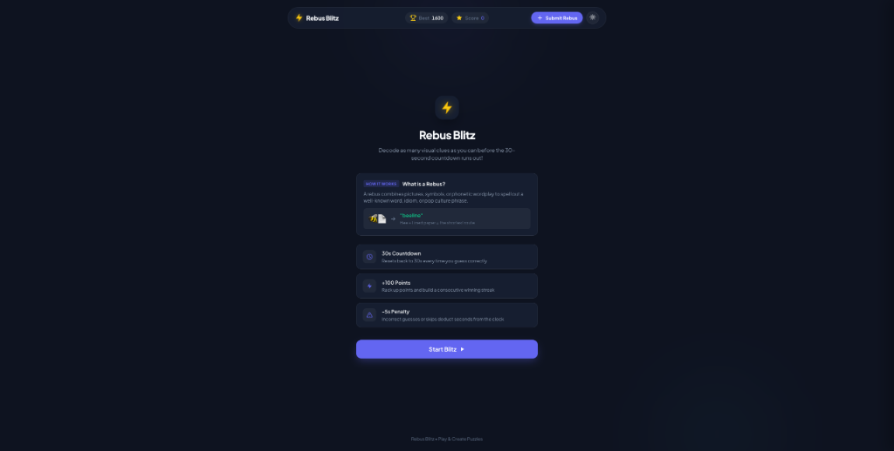
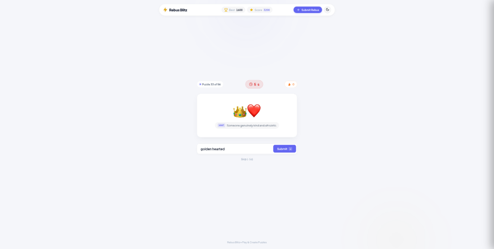
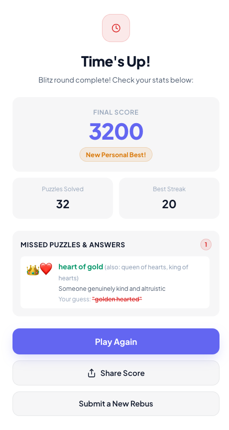
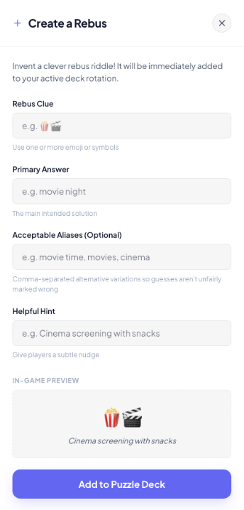

# Rebus Blitz

[](https://rebus-blitz.vercel.app/)
[](https://rebus-blitz.vercel.app/)
[](https://upstash.com)
[]()

Decode visual clues and idioms before the clock runs out at [rebus-blitz.vercel.app](https://rebus-blitz.vercel.app/).

<p align="center">
  
</p>

---

## How It Works

1. **30-Second Survival Clock**: You start with 30 seconds on the timer.
2. **Reset on Success**: Guess correctly, and you get **+100 points** while your timer **resets right back to 30 seconds**.
3. **Penalties**: If you guess wrong or hit Skip, you lose **5 seconds** off the clock.
4. **Endless Run**: As long as you keep guessing accurately, your run stays alive. The game only ends when the timer hits zero.

<p align="center">
  
</p>

---

## What Makes It Different

### 1. Flexible Answers & Aliases
Input normalisation and support for aliases make sensible variations count as a win.

### 2. Post-Game Missed Answer Review
Missed or incorrect puzzles are shown with accepted solutions once game play ends.

<p align="center">
  
</p>

### 3. Community Crowdsourced Riddles
Clicking **+ Submit Rebus** in the header allows players to craft their own riddles and enrich the shared puzzle pool.

<p align="center">
  
</p>

---

## Share Your Run

When you finish a round, you can copy your stats directly to your clipboard in one tap:

```text
⚡ Rebus Blitz
Score: 3,200 pts | Solved: 32 | Streak: 20 🔥
Can you beat my blitz run?
https://rebus-blitz.vercel.app/
```

---

## Tech Under the Hood

Kept intentionally lightweight and dependency-free:

- **Frontend**: Vanilla HTML5, modern CSS with responsive design tokens, and ES modules.
- **Backend**: Node.js serverless functions running on Vercel (`/api/puzzles`, `/api/submit`).
- **Database**: Upstash Redis (Vercel KV) for persistent community-submitted puzzles, with a built-in memory fallback for local development.

---

## Running Locally

To run the project on your machine:

1. Clone the repository:
   ```bash
   git clone https://github.com/abhilashini/rebus-blitz.git
   cd rebus-blitz
   ```

2. Start the local server:
   ```bash
   npx serve public
   ```
   Open `http://localhost:3000` in your browser.

*(Optional)* If you want to test the serverless API functions locally, install the Vercel CLI and run `vercel dev`.
